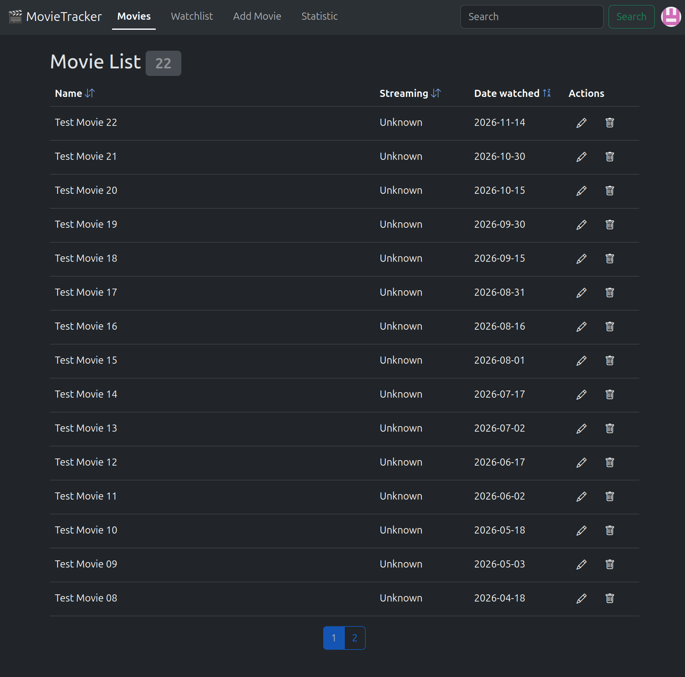

# Movietracker

A small web app to keep a list of the movies I have watched and the ones I still want to watch. You log in with your GitHub account, and every user only sees their own movies.



## What it does

- Keep a watchlist and a list of watched movies, with the date you watched them
- Search your watched movies by name
- Paste a link from Netflix, Amazon, YouTube or the ARD media library. The app remembers the service and the movie id and links back to it.
- Show how many movies you watched per month, split by service
- Delete your account together with all your data

## Built with

Java 21, Spring Boot, Spring Security (GitHub OAuth2 login), Spring Data JPA, Thymeleaf and Bootstrap. Data is stored in an H2 file database by default. PostgreSQL works too, see below.

## Running it locally

You need Java 21 and a GitHub OAuth app:

1. Go to https://github.com/settings/developers and create a new OAuth app.
2. Set the callback URL to `http://localhost:8080/login/oauth2/code/github`.
3. Copy the client id and generate a client secret.

Then start the app with the credentials in the environment:

```bash
export GITHUB_CLIENT_ID=your-client-id
export GITHUB_CLIENT_SECRET=your-client-secret
./mvnw spring-boot:run
```

On Windows use `set` instead of `export`.

Open http://localhost:8080 and log in with GitHub. The database file is created at `~/movietrackerdb.mv.db`.


## Database

By default the app uses the H2 file above. To use another database, set these properties or the matching environment variables:

| Property | Default |
|---|---|
| `db-url` | `jdbc:h2:file:~/movietrackerdb` |
| `db-username` | empty |
| `db-password` | empty |
| `db-driver` | `org.h2.Driver` |

The PostgreSQL driver is already on the classpath. The schema is created and updated by Hibernate (`ddl-auto=update`), there are no migration scripts.

## Docker

```bash
./mvnw clean package
docker build -t movietracker:latest .

docker run --rm -p 8080:8080 \
  -e github-client-id=your-client-id \
  -e github-client-secret=your-client-secret \
  movietracker:latest
```

This stores the H2 file inside the container, so the data is gone when the container is removed. For anything you want to keep, point `db-url` at PostgreSQL or at a mounted volume.

## Tests

```bash
./mvnw test
```

The tests use an in-memory database, except `MovietrackerApplicationTests`, which uses the default H2 file. Stop a running instance of the app before you run it, because the file is locked while the app is open.
